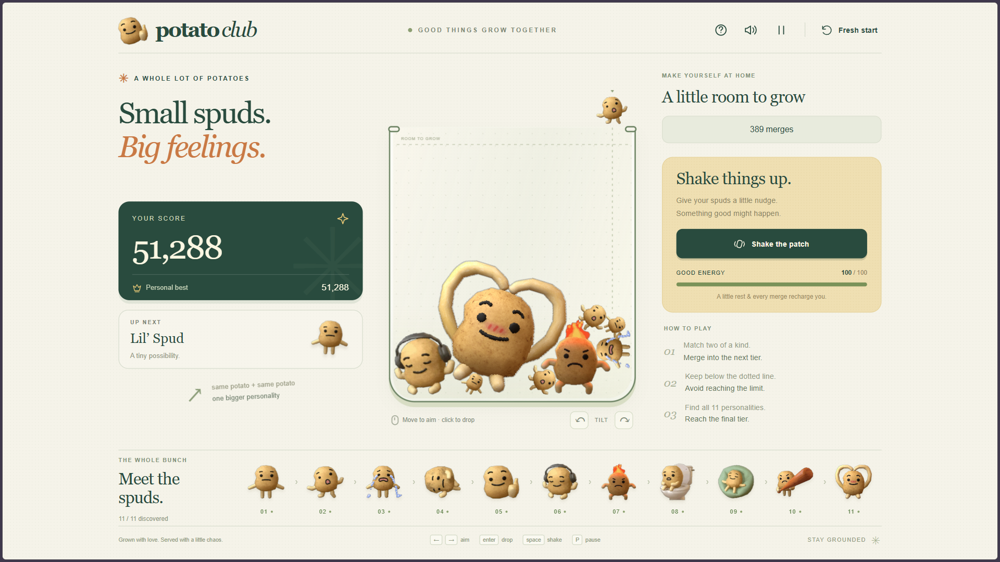

<div align="center">

# 🥔 Potato Club

**A desktop and mobile potato merge game with eleven characters, jiggly physics, and no build step.**

[**Play Now →**](https://spud-xi.vercel.app/)


<!-- Replace with a real screenshot or GIF -->


</div>

---

## Overview

Drop potatoes into the box and merge matching pairs to evolve them through eleven tiers, all the way to the ultimate potato. Built with static HTML, CSS, Canvas 2D, and Matter.js. There is no build step and no runtime service dependencies.

## Features

- Eleven merge tiers with chain score multipliers
- Soft, jiggly, bouncy physics in a single combined setting
- Rechargeable shake and an overflow grace period
- End screen and an ultimate-potato celebration
- Louder synthesized sound with a peak compressor
- Reduced-motion support
- Saved progress and personal best
- Responsive layouts for desktop, mobile portrait, and landscape

## Controls

| Input    | Action                                     |
| -------- | ------------------------------------------ |
| Mouse    | Move to aim, click to drop                 |
| Keyboard | Arrows to aim, **Enter** to drop           |
| Keyboard | **A** / **D** to tilt, **Space** to shake  |
| Keyboard | **P** to pause                             |
| Touch    | Drag across the board to aim, lift to drop |

### Mobile

Play upright for a full-screen portrait layout: score and next potato above the board, tilt and shake controls below it, and a **Meet the spuds** button for the full collection. The game fits the available browser height. Opening the collection or help panel pauses the round, and closing it restores the previous pause state.

## Run Locally

Requires **Node.js 18 or newer**. No package installation or build is needed.

**Windows:** double-click **Start Potato Club.cmd**. It starts the game and opens your browser. Keep the terminal window open while playing; close it or press `Ctrl+C` to stop.

**Any platform:**

```bash
node serve.mjs
```

Then open [http://127.0.0.1:4173/](http://127.0.0.1:4173/). The server only listens on your computer, and all code and artwork are included locally, so no internet connection is needed. The `dist/` folder is the finished production game.

## Saves and Progress

Progress and personal best are stored in your browser's `localStorage`. A fresh start keeps your best score and discovered characters. Existing version-1 saves remain compatible.

Saves belong to the address you play on, so progress on the [hosted version](https://spud-xi.vercel.app/) and on `http://127.0.0.1:4173/` are separate and do not transfer. To keep your progress, always use the same address in the same browser profile.

## How It Works

**Shapes.** Characters render as the original transparent PNGs, with no circular backplates or round colliders. `scripts/build-shapes.cjs` reads each PNG's alpha channel, traces the main connected silhouette and its transparent holes, simplifies the contour, triangulates it with Earcut, and combines convex pieces into compound Matter.js bodies. Detached tear droplets and tiny alpha specks stay decorative. The outlines approximate the pixels for stable, efficient collisions.

After replacing artwork, rebuild the shapes:

```bash
node scripts/build-shapes.cjs
```

**Jelly physics.** Impacts drive a damped squash-and-stretch spring with a gentle rebound and a soft wobble. The collider and sprite share the same area-preserving deformation, so contacts stay aligned. This is a springy deforming silhouette, not a full cloth or fluid simulation. Reduced-motion mode disables deformation.

## Testing

```bash
node tests/physics.test.cjs
```

Covers merges, silhouette bounds, transparent holes, landing jiggle, rebound, cooldowns, pauses, shake cost, overflow, and persistence.

## Deployment

The live game is hosted on Vercel at [spud-xi.vercel.app](https://spud-xi.vercel.app/). It is a plain static site: to host it anywhere else, serve the contents of `dist/` as a static website. There is no backend and no online leaderboard.

## Credits and Licenses

- [Matter.js](https://brm.io/matter-js/) is vendored in `dist/assets/matter.min.js` with its MIT license header intact.
- [Earcut](https://github.com/mapbox/earcut) is used only by the offline shape builder. Its ISC license is in `scripts/lib/EARCUT-LICENSE.txt`.
